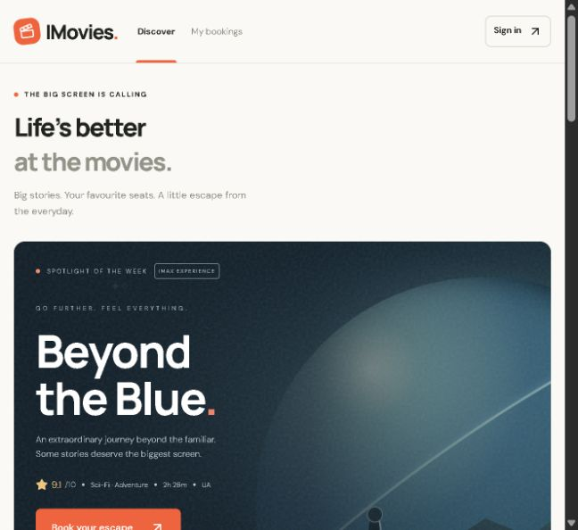
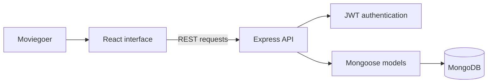

<div align="center">

# IMovies.

### A little escape. A lot of feeling.

A cinema-inspired movie booking app built with the MERN stack.<br/>
Discover a story. Find your show. Make that seat yours.


[The experience](#the-experience) · [Run locally](#run-locally) · [Under the hood](#under-the-hood) · [API](#api-at-a-glance)

</div>

---

## Movie night starts before the opening credits

Finding a film should feel like part of the experience. IMovies brings a warm, editorial style to a familiar flow: browse the lineup, pick a showtime, choose your seats, and keep your reservations in one place.

The interface pairs an ink-blue spotlight with warm ivory surfaces, orange accents, and original CSS-rendered movie artwork. Behind it is a working Express API with MongoDB storage, authenticated bookings, and atomic seat allocation.

> **Project status:** A working local demo. The catalog is fictional, reservations are simulated, and no money changes hands. There is no hosted application demo yet.

<div align="center">
  
  <p><sub>The home screen, captured from the running application.</sub></p>
</div>

## The experience

| From browsing to booked | What you can do |
| --- | --- |
| **Find your next favourite** | Explore six fictional films, search by title, and filter by genre or language. |
| **Pick the right showing** | Browse seven days of seeded showtimes across three illustrative Mumbai cinemas, including 2D, IMAX, and Dolby Atmos formats. |
| **Choose your spot** | Select up to eight seats on an 80-seat map. Availability refreshes every five seconds. |
| **Know the total** | See ticket prices and the 8% booking fee before confirming. The server calculates the final amount. |
| **Make it official** | Create an account, sign in, and receive a reservation confirmation with a booking reference. |
| **Keep plans together** | Find your tickets in **My bookings**, or cancel a reservation to release its seats. |

Responsive layouts, labelled inputs, modal keyboard focus management, and reduced-motion support carry the experience across screen sizes.

### Take it for a spin

1. Open a film from **Discover** and choose a date.
2. Pick a cinema and showtime. Shows that have already started cannot be booked.
3. Select your seats and review the total.
4. Create a demo account or sign in, then confirm your reservation.
5. Open **My bookings** to see the ticket or cancel it.

No default account or payment details are needed. If today's shows have finished, choose tomorrow.

## Run locally

### Prerequisites

- **Node.js 22.12+** and **npm**.
- Internet access for dependency installation and, on first use, the temporary MongoDB binary download.
- A MongoDB connection is optional for the default demo.

### Quick start

```bash
git clone https://github.com/vedantgour206/IMovies.git
cd IMovies
npm ci
npm run dev
```

Open **[localhost:5174](http://127.0.0.1:5174)**. Vite serves the interface and forwards `/api` requests to Express at **[localhost:4100](http://127.0.0.1:4100)**.

The first launch seeds the movie catalog and showtimes automatically. Create your own demo account from **Sign in → Create an account**.

> **Demo storage:** Without `MONGODB_URI`, the app launches a real temporary MongoDB process through `mongodb-memory-server`. Accounts, reservations, and seat changes reset when the server stops. A fresh JWT signing secret is generated for each demo session.

### Serve the production build locally

```bash
npm run build
npm start
```

Open **[localhost:4100](http://127.0.0.1:4100)**. Express serves both the compiled frontend and the API.

<details>
<summary><strong>Windows PowerShell launcher</strong></summary>

After installing dependencies, run this from the project folder:

```powershell
.\Start-IMovies.ps1
```

The launcher builds the frontend and starts the application. To start both development servers instead:

```powershell
.\Start-IMovies.ps1 -Development
```

It uses Node.js from your PATH, with a fallback to the Codex bundled runtime when available on this laptop.

</details>

### Keep your data between sessions

Copy `.env.example` to `.env` and configure a persistent MongoDB database:

```dotenv
PORT=4100
MONGODB_URI=mongodb://127.0.0.1:27017/imovies
JWT_SECRET=replace-with-a-random-secret-of-at-least-32-characters
```

Generate a random signing secret with:

```bash
node -e "console.log(require('node:crypto').randomBytes(48).toString('hex'))"
```

Replace the placeholder with the generated value. Keep `.env` private; it is excluded from Git.

| Variable | Default | Purpose |
| --- | --- | --- |
| `PORT` | `4100` | Express server port. |
| `MONGODB_URI` | Unset | Uses temporary demo MongoDB when omitted; uses your database when set. |
| `JWT_SECRET` | Generated in demo mode | Required to be at least 32 characters with a persistent database. |

The development proxy targets port `4100`. If you change the API port, update `vite.config.js` to match.

**About the seed data:** Seeding runs only when the movie collection is empty. It creates showtimes for the seven days beginning on that first launch, using India time. A persistent database does not automatically receive a new week of shows; maintain future show records through MongoDB or use a fresh demo database.

## Under the hood



| Layer | Built with |
| --- | --- |
| Interface | React 19, custom responsive CSS, Lucide icons |
| Development and bundling | Vite 7 |
| API | Node.js, Express 5 |
| Data | MongoDB, Mongoose |
| Authentication | bcrypt password hashing, signed JWTs |
| Request safeguards | Input validation, rate limiting, Helmet headers |
| Integration tests | Node.js test runner, Supertest, temporary MongoDB |

### One seat. One successful reservation.

Seat selection in the browser is a preference, not a temporary hold. When a booking reaches the API, MongoDB performs a conditional atomic update: it reserves the requested seats only if none of them are already occupied. Competing requests for the same seats cannot both claim them through that update; the unsuccessful request receives a `409` response.

The server also validates seat identifiers, rejects duplicates, enforces the eight-seat limit, checks the show's start time, and calculates the total independently of the browser. Users can list and cancel only their own bookings.

If the booking insert fails after seats are allocated, the API attempts to release those seats. Booking creation and cancellation span multiple writes; they are **not cross-document transactions**. A production service would need transactional consistency and recovery for interrupted operations.

### Project map

```text
IMovies/
├── src/
│   ├── main.jsx              # Discovery, authentication, seats, and bookings
│   └── style.css             # Visual system, poster artwork, responsive layouts
├── server/
│   ├── app.js                # REST routes, validation, authentication
│   ├── app.test.js           # Integration coverage for the reservation lifecycle
│   ├── index.js              # Database startup and production file serving
│   ├── models.js             # User, Movie, Show, and Booking schemas
│   └── seed.js               # Fictional catalog and initial showtimes
├── docs/images/              # README preview
├── .env.example              # Environment configuration template
├── Start-IMovies.ps1          # Windows launcher
└── vite.config.js            # React plugin and development API proxy
```

## API at a glance

Protected endpoints expect `Authorization: Bearer <token>`.

| Method | Endpoint | Purpose | Sign-in required |
| --- | --- | --- | :---: |
| `GET` | `/api/health` | API and database readiness | — |
| `POST` | `/api/auth/register` | Create an account and receive a token | — |
| `POST` | `/api/auth/login` | Sign in and receive a token | — |
| `GET` | `/api/auth/me` | Read the current user profile | ✓ |
| `GET` | `/api/movies` | List the movie catalog | — |
| `GET` | `/api/shows?movie=<id>&date=YYYY-MM-DD` | List a movie's shows for a date | — |
| `GET` | `/api/shows/:id` | Read show details and occupied seats | — |
| `GET` | `/api/bookings` | List the current user's bookings | ✓ |
| `POST` | `/api/bookings` | Reserve seats for a show | ✓ |
| `PATCH` | `/api/bookings/:id/cancel` | Cancel an owned, active booking | ✓ |

Example reservation body:

```json
{
  "showId": "<show-id-from-the-api>",
  "seats": ["E5", "E6"]
}
```

The total comes from the show's stored price plus the booking fee. Clients do not supply a trusted price.

## Checks that matter

```bash
npm test
npm run build
```

The integration test uses an isolated temporary MongoDB instance and exercises the reservation lifecycle:

- Registration validation, duplicate email handling, and successful and unsuccessful login.
- Authentication requirements and user-specific booking access.
- Invalid and duplicate seat rejection.
- Two concurrent requests for the same seats, with exactly one successful booking.
- Server-side pricing when a client submits a different total.
- Cancellation ownership, repeated cancellation rejection, seat release, and rebooking.

The build command verifies that Vite can produce the frontend bundle. No CI workflow is currently configured.

## Scope, with the lights on

IMovies is a focused learning and portfolio project built from a SkillWallet movie-booking brief. It demonstrates an end-to-end MERN reservation flow while keeping the setup approachable.

- **Illustrative content:** Movies, ratings, cinema listings, prices, and seat availability are sample data. There is no connection to real cinema inventory.
- **Reservations only:** No payment processing, refund handling, email delivery, or downloadable ticket export is implemented.
- **Customer-facing flow:** There is no administration interface for managing movies or showtimes.
- **Polling availability:** Seat updates refresh every five seconds; there are no WebSockets or expiring seat holds.
- **Local serving:** The server binds to `127.0.0.1`. Public hosting requires deployment configuration.
- **Before real bookings:** Add transactional booking writes, recovery, payment integration, operational monitoring, and a production security review. Helmet is enabled with Content Security Policy disabled in the current configuration.

Poster artwork is rendered locally in CSS. Google Fonts enhances the typography when available; fallback fonts keep the app usable without it.

## Make it yours

Want to extend the experience? Good next steps include an admin dashboard, expiring seat holds, automated show scheduling, and an accessible ticket export. Start with a focused change, keep the reservation rules on the server, and run the integration test and build before opening a pull request.

Found a bug or have an idea? [Open an issue](https://github.com/vedantgour206/IMovies/issues) with the steps to reproduce it or a short description of the improvement.

---

<div align="center">

**Your next great escape starts with a seat.**

[Explore the code](https://github.com/vedantgour206/IMovies) · [Report an issue](https://github.com/vedantgour206/IMovies/issues)

<sub>If you enjoyed the project, a star is always appreciated.</sub>

</div>
